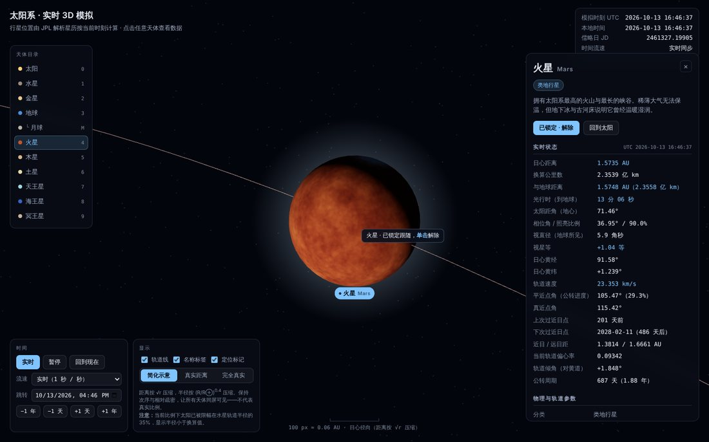
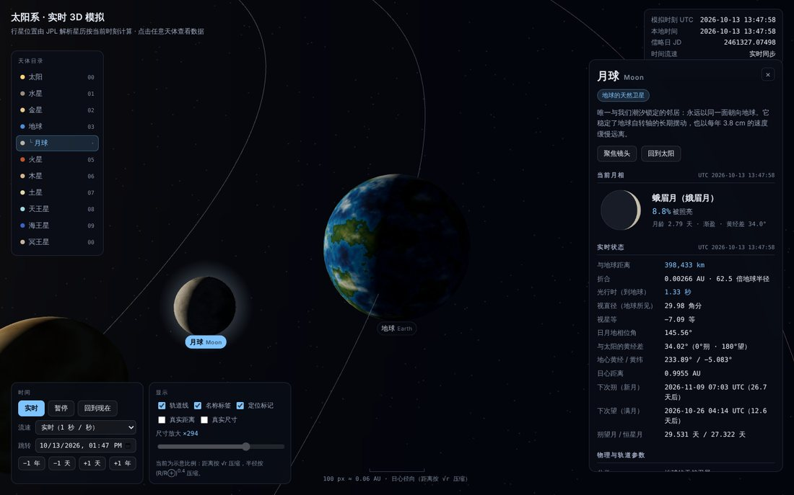
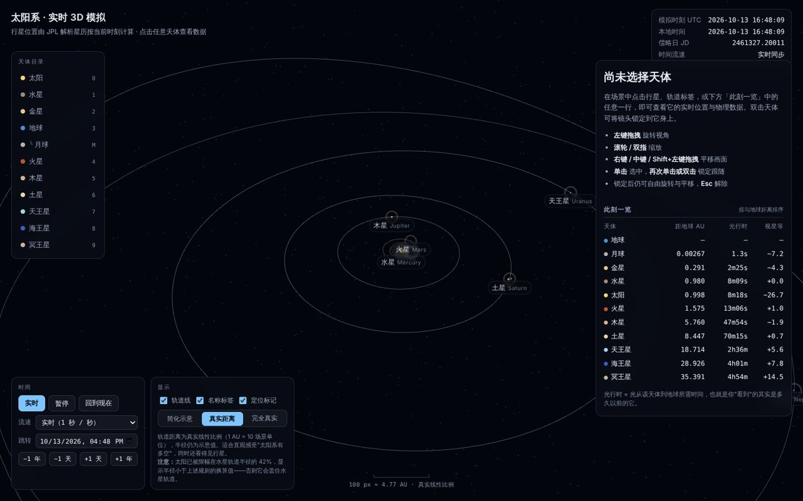

# 太阳系 · 实时 3D 模拟

一个单页、零依赖安装、**双击即可打开**的太阳系三维模拟。行星与月球的位置不是动画循环，而是按**当前真实时刻**由解析星历算出来的；点击任意天体即可查看它此刻的日心距离、与地球的距离、光行时、轨道速度、相位角、视星等等实时量，以及物理与轨道参数。月球还会给出实时月相（相位名称、照亮比例、月龄、下次朔望时刻）。





---

## 1. 运行

```bash
# 方式一：单文件版（最省事，整个项目打包成一个 HTML，双击即可）
open solar-system-3d/dist/solar-system.html

# 方式二：多文件版（源码结构，便于修改）
open solar-system-3d/index.html        # macOS
start solar-system-3d\index.html       # Windows

# 方式三：本地服务器（若浏览器对 file:// 有额外限制）
cd solar-system-3d && python3 -m http.server 8080
# 浏览器打开 http://localhost:8080
```

`dist/solar-system.html`（约 765 KB）是把 `styles.css` 与全部脚本按原加载顺序内联后的产物，**零外部引用**（0 个 `<link href>`、0 个 `<script src>`、0 个 `url()`），可随意拷贝、离线打开或发给别人。它由 `tools/build-single-file.mjs` 生成，不要直接编辑——改源文件后重新生成：

```bash
node tools/build-single-file.mjs            # → dist/solar-system.html
node tests/smoke.mjs dist/solar-system.html # 用同一套断言验证打包版
```

无需 npm install、无构建步骤、无外部网络请求（three.js 已内置，纹理全部运行时程序化生成）。
要求：支持 WebGL 的现代浏览器。已在 Chromium 上验证；Firefox / Safari 同样使用标准 API，但未逐一实测。

## 2. 操作

| 操作 | 效果 |
| --- | --- |
| 左键拖拽 | 旋转视角 |
| 滚轮 / 双指捏合 | 缩放 |
| 右键 / 中键 / `Shift`+左键拖拽 | 平移画面（1:1 跟随光标） |
| 单击天体 / 标签 / 目录 / 列表 | 选中并显示数据 |
| **再次单击**已选中的天体 / 双击 | 锁定跟随（镜头持续跟住它） |
| 锁定后 | 仍可自由旋转、平移、缩放；再单击一次或 `Esc` 解除 |
| `Esc` | 解除锁定与选择（画面停在原处，不跳回太阳） |
| `空格` | 暂停 / 继续 |
| `0`–`9` / `M` | 依次选中 太阳、水星…冥王星 / 月球 |
| `F` / `R` / `O` / `L` | 聚焦 / 回到现在 / 轨道线 / 标签 |
| 方向键 / `+` `-` | 旋转视角 / 缩放（全键盘可操作，无需鼠标） |

时间面板支持：实时同步、1 分钟~1 年每秒的流速、暂停、任意日期跳转、±1 天 / ±1 年步进。
显示面板支持：轨道线、名称标签、**定位标记**，以及**三挡比例模型**（简化示意 / 真实距离 / 完全真实）。

界面上还有三处常驻信息：左侧**天体目录**（固定顺序的导航锚点）、底部**屏幕比例尺**（100 px 对应多少 AU）、右侧**此刻一览**（按与地球的实时距离排序，含光行时与视星等）。

## 3. 文件结构

```
solar-system-3d/
├── index.html              页面骨架（控件与面板的静态结构）
├── styles.css              界面样式
├── src/
│   ├── ephemeris.js        轨道要素与开普勒求解 → 日心黄道坐标
│   ├── data.js             天体静态数据（物理参数、调色板、渲染参数）
│   ├── textures.js         程序化纹理（值噪声 / fBm，Canvas 像素级生成）
│   ├── controls.js         自写轨道相机（含拖拽与点击的区分）
│   ├── app.js              场景搭建、比例映射、拾取、主循环
│   └── ui.js               标签、信息面板、时间与显示控制
├── vendor/three.bundle.js  three.js r169（MIT），由下方脚本生成
├── dist/solar-system.html  单文件打包产物（生成物，勿直接编辑）
├── tests/smoke.mjs         Playwright 冒烟测试（22 项断言）
└── tools/
    ├── make-three-bundle.mjs   把官方 ESM 构建改写成全局脚本
    └── build-single-file.mjs   把全部样式与脚本内联成单文件
```

分层原则：`app.js` 只管场景与状态，`ui.js` 只读状态写 DOM，两者通过 `SolarSystem.App.state` 单向耦合。

### 交互设计的借鉴

左侧**天体目录**、**定位标记**（固定像素大小的空心环，真实比例下行星缩成亚像素点时靠它定位与点击）、底部**屏幕比例尺**、以及**标签防重叠**这四项，来自一个外部参考页（"ORBIT · 真实比例太阳系"）的交互设计。它的物理是示意性的（页脚自述"非真实星历、轨道初相位为示意、平均日距圆轨道"），所以只借交互与信息设计，不借数据模型。其中比例尺按本页的非线性映射重做了：压缩模式下不能取导数（太阳处 dr/dd→0，会给出"100 px ≈ 33 km"这种荒谬读数），改为取割线，并标明是日心径向比例。

## 4. 关键设计决策与取舍

### 4.1 为什么不用 ES module + OrbitControls

浏览器在 `file://` 下禁止加载 ES module。要让文件双击可用，就不能用 `import`，也就用不了 `three/examples/jsm` 里的 `OrbitControls`。
于是：把官方 ESM 构建的末尾 `export{...}` 机械改写为 `window.THREE = {...}`（`tools/make-three-bundle.mjs`，只改这一处），相机控制自己写 150 行。
附带收益：能精确区分「拖拽」与「点击」（位移 < 6 px 且 < 450 ms 才算点击），这对小目标拾取很关键。

### 4.2 位置怎么算

采用 Standish / JPL《Keplerian Elements for Approximate Positions of the Major Planets》(1800–2050) 的六要素线性模型：

```
要素(T) = 要素₀ + 变化率 · T,  T = (JD − 2451545.0) / 36525
M = L − ϖ  →  牛顿迭代解 E − e·sinE = M  →  轨道面坐标  →  三次旋转(ω, I, Ω) → J2000 日心黄道坐标
```

**精度边界（重要）**：这是解析近似，不是 DE440 数值积分星历。内行星黄经误差约 10 角秒量级，木星土星可达数角分，冥王星更差；未做 TT−UTC（约 69 s）修正，也未计行星互相摄动。用来回答"此刻火星大概在哪、离我们多远"完全够用；**不可用于掩星预报、历表级计算或任何需要角秒精度的场合**。

验证方式：与公开历表交叉核对若干可独立检验的量级，例如 2026-10-13 的地心太阳视黄经约 199.8°（符合 10 月中旬太阳位于天秤座约 20° 的事实）、土星下次过近日点 2032-12（符合其 1944/1974/2003 的近日点序列）、地球日心距 0.998 AU（10 月正趋向 1 月近日点）。

### 4.3 月球与实时月相

月球不走开普勒要素，而是用 **ELP2000-82B 的截断式**（Meeus《Astronomical Algorithms》第 47 章）：黄经保留振幅最大的 19 项、黄纬 13 项、距离 13 项。

验证（都是可独立复核的量）：

| 检验项 | 本实现 | 参照 | 偏差 |
| --- | --- | --- | --- |
| Meeus 例 47.a（1992-04-12 0h TD）黄经 | 133.157214° | 133.162655° | **0.0054°** |
| 同上 黄纬 | −3.226930° | −3.229126° | 0.0022° |
| 同上 地心距 | 368,392.3 km | 368,409.7 km | 17.4 km |
| 139 个朔望月平均间隔 | 29.53095 天 | 29.530588 天 | **0.5 分钟** |
| 恒星月 | 27.3221 天 | 27.32166 天 | 0.0004 天 |
| 2026 年地心距区间 | 356,688–406,430 km | ≈356,500–406,700 km | — |
| 1992-04-12 月龄 | 9.09 天、盈凸、照亮 67.8% | 该月 04-03 朔、04-17 望 | 一致 |

两处实现细节值得记下来：

1. **坐标系对齐**：ELP 给的是"当日平分点"黄道坐标，行星用的是 J2000。直接混用会在跨年尺度上产生肉眼可见的偏移（2026 年约 0.37°），所以对月球黄经做了一阶总岁差改正（1.397159°/世纪）。
2. **相位命名不按 45° 均分八等份**。均分会把黄经差 110°（照亮 68%，明显是凸月）叫成"上弦"。朔、望、上下弦本质是四个瞬时事件，这里给它们各 ±7.5°（约 ±0.6 天）的窄窗口，其余归入蛾眉 / 凸 / 残。
3. **月相图方向**按北半球视角：渐盈亮面在右、渐亏在左，界面上明确标注（南半球左右相反）。这一条有逐相位的像素级断言守着。

场景里的月球：**方向是真的，距离是压缩的**。显示间距 = `clamp(真实间距, 2.6·R母, 真实比值·R母)`——当没有任何尺寸夸张（真实尺寸 ×1）时上限不生效，呈现真实的约 60 倍地球半径；一旦把地球画大，间距就被压到 2.6 倍半径，否则月球会被地球吞掉。月球还按潮汐锁定摆放，纹理中心（月海密集的近地面）始终朝向地球。

### 4.4 视星等

`V = V(1,0) + 5·log₁₀(r·Δ) + 相位改正`，V(1,0) 与相位多项式取自《Astronomical Almanac》经典式。2026-10-13 的输出与实际量级一致：天王星 +5.6（肉眼极限附近）、海王星 +7.8（必须用望远镜）、冥王星 +14.5、金星 −4.3。

**已知偏差（界面上也写明了）**：土星只算球体、不含环的贡献，环面张角最大时实际可亮 0.3–1.0 等；金星在相位角 >163.6° 的极细月牙区间公式不适用；不含大气消光。

### 4.5 比例：三挡模型，互斥而非勾选

真实比例下，若太阳画成 1 px，海王星在约 2.4 m 外 —— 行星全部不可见。可视化必须压缩，关键是**把压缩方式讲清楚**，并且不让用户拼出自相矛盾的组合。因此改成三挡互斥模型（原先的两个复选框 + 尺寸放大滑杆已移除）：

| 模型 | 距离映射 | 半径映射 | 用途 |
| --- | --- | --- | --- |
| **简化示意**（默认） | `d = 10·√r` | `R = 0.38·(R/R⊕)^0.4` | 保持次序与相对疏密，所有天体同屏可见 |
| **真实距离** | `d = 10·r` | 同上（示意值） | 感受"太阳系有多空"，同时还看得见行星 |
| **完全真实** | `d = 10·r` | 真实半径同系数换算 | 1:1，无任何放大 |

**"完全真实"是经过验证的 1:1，不是形容词。** 冒烟测试直接量场景里的几何，与真实公里数逐项对账（相对误差 <1e-9）：

| 对账项 | 场景实测 | 真实值 |
| --- | --- | --- |
| 水星 半径/日心距 | 3.788077e-5 | 3.788077e-5 |
| 地球 半径/日心距 | 4.268551e-5 | 4.268551e-5 |
| 木星 半径/日心距 | 8.802933e-5 | 8.802933e-5 |
| 海王星 半径/日心距 | 5.508817e-6 | 5.508817e-6 |
| 太阳半径 / 地球轨道半径 | 0.00466546 | 0.00466546（≈1/107） |
| 地月距离 / 地球半径 | 62.60 | 62.60 |

八大行星全部在列，这里只摘了四行。作为对照，测试同时断言"简化示意"模式下地球半径被放大约 **891 倍**——模式语义必须自洽，不能两边都号称真实。

另有一条防御性限幅：任何天体显示半径不超过自身轨道半径的 45%（太阳以水星轨道为参照取 42%）。阈值取 42% 是算出来的——示意太阳半径恰为水星轨道的 39.7%，默认模式因此**不触发**限幅；而"真实距离 + 示意半径"这个组合会触发（否则太阳会盖住水星轨道），此时界面明确标注。完全真实模式下太阳半径仅为水星轨道的 1.2%，自然不触发。

### 4.6 拾取用屏幕空间而非射线求交

压缩比例下行星常常只有 2–8 px，`Raycaster` 对球体求交几乎点不中。改为把天体中心投影到屏幕，比较像素距离，容差取 `max(16 px, 屏幕半径 + 10 px)`。代价是遮挡关系被忽略（被太阳挡住的行星仍可点中），换来的是符合直觉的点击手感。

### 4.7 纹理全部程序化

9 个天体的表面贴图在运行时用 Canvas 逐像素生成（值噪声 + fBm + 调色板映射）：仓库零贴图资源、离线可用、无版权问题。
经纬度贴图的接缝问题用圆柱采样解决：把经度映射到 `(cosθ·cosφ, sinθ·cosφ, sinφ)` 再取 3D 噪声，经度方向天然闭合。
代价：外观是"示意级"的，不是探测器真实影像——木星的大红斑位置、火星极冠是按参数摆的，不代表真实地貌。

### 4.8 可用性与可访问性

按 WCAG 2.1 AA 过了一遍，改动都在仓库里：

| 问题 | 处理 |
| --- | --- |
| 1.4.3 对比度：次要文字 `#6b7689` 在面板底色上只有 **4.22:1**，未达 4.5:1 | 提亮到 `#7d8a9e`（5.4:1） |
| 2.1.1 全键盘可操作：视角只能用鼠标转 | canvas 可聚焦，方向键旋转、`+`/`-` 缩放 |
| 2.4.7 焦点可见：无焦点指示 | 统一 `:focus-visible` 描边（鼠标点击不出现） |
| 4.1.2 名称/角色/值：标签与目录是带点击事件的 `div` | 改为真正的 `<button>`，开关加 `role="switch"`，目录项用 `aria-current` |
| 4.1.3 状态播报：面板数值每秒刷新 9 次 | **没有**给面板加 `aria-live`（那会让读屏器以 9 Hz 念数字），改为只在选中项变化时向专用状态区播报一次 |
| 2.5.5 触控目标 | 窄屏上目录项与按钮提到 ≥44 / 32 px |
| 2.3.3 动态效果 | 支持 `prefers-reduced-motion`（3D 场景本身是内容，保留） |

### 4.9 诚实性：星历有效区间

Standish 根数表的标称区间是 1800–2050。日期输入框按此设 `min`/`max`，而时间推进**不**阻止你飞到 3000 年（看看那时行星在哪本身是有趣的），但一旦越界，页面顶部会出现明确警告说明结果不可信。宁可让人看见模型的边界，也不要让人以为任何年份的输出都一样可靠。

### 4.10 相机：注视点 = 基准 + 平移偏移

早期版本里右键平移**完全不生效**，原因不在事件处理，而在架构：主循环每帧都调用 `setTarget()` 重设注视点（锁定时设为天体位置，否则强制设为原点），用户拖出来的偏移在同一帧就被覆盖。

修法是把注视点拆成两项：

```
注视点 = 基准点（场景每帧给的，可能在跟随天体）+ 平移偏移（用户拖出来的，持久）
```

于是锁定跟随与自由平移可以共存——这正是"锁定了镜头但不该锁死鼠标"的要求。平移量按"目标平面上 1 像素等于多少世界单位"换算（`2·tan(fov/2)·distance / 视口高度`），画面因此 1:1 跟着光标走，而不是一个凭手感调出来的系数。

解除锁定时还有一个细节：如果直接把基准点设回原点，镜头会被"吸"回太阳。所以解除时把当前注视点转存进平移偏移，两者相加仍是同一点，画面纹丝不动；只有显式点「回到太阳」才重新取景。

### 4.11 其它工程细节

- **时间推进**：每帧 `dt` 上限 0.5 s。设太小，低帧率机器上「30 天/秒」会名不副实；不设限，后台标签页切回时会瞬间跳过大段时间。
- **相机阻尼**：用 `1 − e^(−9·dt)` 而非固定系数，保证低帧率下也能跟上目标。
- **深度缓冲**：开启对数深度缓冲，真实比例模式下场景跨越约 5 个数量级。
- **DOM 更新**：文本按 ~9 Hz 节流，表格结构只建一次、之后只改单元格文本（避免打断文本选择与闪烁）；标签位置每帧更新。
- **自转相位**以 J2000 为零点计算，时间来回拖动时可复现，而不是逐帧累加。

## 5. 已知局限

1. 只含月球一颗卫星；不含伽利略卫星、土卫等，也不含小行星带与彗星。
2. 冥王星的解析星历精度最低，仅供示意（界面上已标注）。
3. 轨道线按当前时刻的要素冻结绘制，不表现长期摄动与进动。
4. 压缩距离模式下轨道形状被径向压缩，偏心率的视觉表现会减弱（真实距离模式下恢复）。
5. 没有光照遮挡：不做行星投影、环影与日食（月相是算出来的，不是渲染出来的阴影）。
6. 视星等不含土星环与大气消光（见 4.4）。
7. 卫星数量按 2024 年已确认值，外行星小卫星仍在陆续发现。

## 6. 可扩展方向

- 加入伽利略卫星（需要 L1/E5 类卫星历，或接受更粗的圆轨道近似）。
- 接 JPL Horizons API 做在线校正，并与本地解析解对比显示误差。
- 加"从地球看"的星空模式：把日心坐标转为地心赤道坐标，叠加星座。
- 加视星等模型（相位函数 + 距离项），让亮度排序也成为实时数据。

## 7. 重新生成 three.js 包

```bash
curl -L -o /tmp/three.module.min.js \
  https://cdn.jsdelivr.net/npm/three@0.169.0/build/three.module.min.js
node tools/make-three-bundle.mjs /tmp/three.module.min.js vendor/three.bundle.js
```

## 8. 验证

```bash
npm i -D playwright && npx playwright install chromium   # 仅测试需要
node tests/smoke.mjs
```

`tests/smoke.mjs` 以 `file://` 打开页面并断言 **71 项**（可传入路径改测单文件版：`node tests/smoke.mjs dist/solar-system.html`）：

- **星历**：各行星日心距是否落在自身近/远日距之间、地球公转速度 ≈29.8 km/s、实时模式与系统时钟偏差 <1 s；
- **月球**：地心距落在 356,000–407,000 km、照亮比例 ∈[0,1]、月龄与黄经差自洽、渐盈渐亏与黄经差一致；
- **月相图**：8 个相位逐个做像素统计，验证亮面方向（渐盈在右、渐亏在左、满月对称、新月全暗）；
- **视星等**：金星 <−3、木星 <−1、天王星 5–6.2、海王星 7.4–8.2；
- **交互**：画布点击能选中、拖拽不被误判为点击、目录点击、定位标记开关、方向键旋转、读屏状态区有播报；
- **相机**：右键拖拽产生平移偏移、偏移不会被每帧的注视点覆盖、`Shift`+左键也能平移；
- **锁定**：第一次单击只选中不锁定、悬浮提示给出"再次单击锁定"、第二次单击锁定、锁定后注视点跟住移动中的天体（30 天/秒快进 5.6 场景单位，滞后 0.22）、锁定状态下仍可旋转与平移且不会被解除、再次单击解除；
- **比例模型**：三挡的距离比（≈30 / ≈√30）、**完全真实模式下 11 项几何比值与真实公里数对账（相对误差 <1e-9）**、简化示意模式确实放大了约 891 倍、太阳限幅未在默认模式触发；
- **时间**：流速与暂停、越界警告出现与消失、比例尺有读数；
- **稳定性**：运行期间无 JS 异常。

本仓库当前提交下，多文件版与单文件打包版的 71 项断言均全部通过（Chromium + SwiftShader 软件渲染）。

## 9. 数据来源

- 轨道要素：E. M. Standish, *Keplerian Elements for Approximate Positions of the Major Planets*, JPL Solar System Dynamics.
- 物理参数：NASA Planetary Fact Sheet / JPL Solar System Dynamics.
- 月球理论与视星等公式：Jean Meeus, *Astronomical Algorithms*（第 47 章月球位置）；《Astronomical Almanac》行星星等式。
- 界面上的「数据来源」区块直接给出这些链接，不只写在本文件里。
- 渲染引擎：[three.js](https://threejs.org/) r169，MIT License（见 `vendor/three.bundle.js` 头部版权声明）。
