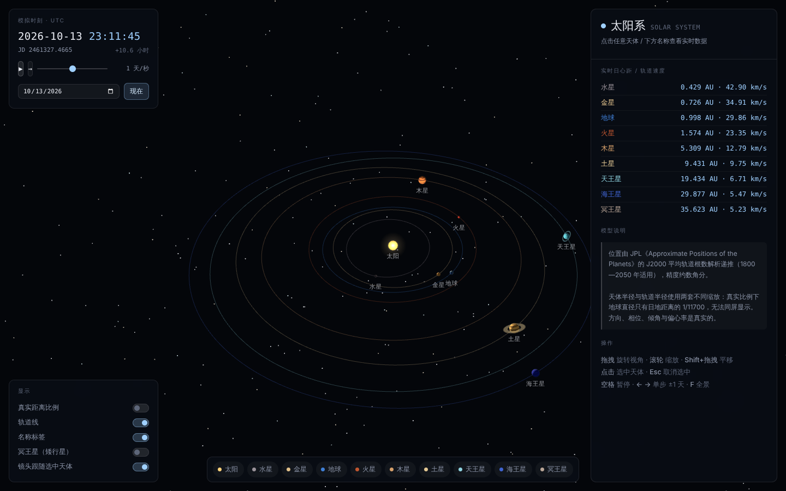

# 太阳系实时 3D 模拟 · Solar System Live

基于 three.js（WebGL）的太阳系三维模拟。行星位置由 **真实轨道根数实时解算**，
而非预设动画：鼠标悬停高亮、点击选中，右侧面板给出该天体在当前模拟时刻的
日心距、轨道速度、与地球的距离与光行时、日距角、被照亮比例等数值。



---

## 运行

无构建步骤、无依赖安装。

```bash
# 方式一：直接双击 index.html（需联网，three.js 自 CDN 加载）

# 方式二：本地起一个静态服务器（推荐）
python3 -m http.server 8000
# 然后访问 http://127.0.0.1:8000/
```

**完全离线运行**：下载 `https://cdn.jsdelivr.net/npm/three@0.152.2/build/three.min.js`
放到本目录下的 `vendor/`，把 `index.html` 里的 CDN `<script src>` 改成 `vendor/three.min.js` 即可。
（仓库不收录第三方构建产物，故未随项目提交。）

> 这里刻意使用 three.js 的 UMD 构建 + 传统 `<script>` 标签，而不是 ES Module + importmap：
> 后者在 `file://` 协议下会被 CORS 拦截，双击打开即白屏。代价是 r150+ 的一条废弃警告。

---

## 交互

| 操作 | 效果 |
| --- | --- |
| 拖拽 | 旋转视角 |
| 滚轮 / 双指捏合 | 缩放 |
| Shift + 拖拽（或右键拖拽） | 平移 |
| 悬停 | 天体高亮、光标变化 |
| 单击天体 / 标签 / 底部名称 | 选中并对焦，展开实时数据 |
| 再次点击同一天体、Esc、F | 取消选中，回到全景 |
| 空格 | 暂停 / 继续 |
| ← → | 单步 ±1 天 |
| R | 时间倒放 / 正放 |

时间控制条支持 **实时 1× → 10 年/秒** 九档倍率、任意日期跳转、「现在」一键回到真实时刻。
左下角可切换真实距离比例、轨道线、标签、冥王星与镜头跟随。

---

## 数据与算法

### 位置解算

| 环节 | 做法 |
| --- | --- |
| 轨道根数 | JPL/Standish《Approximate Positions of the Planets》J2000 平均根数 + 百年变化率 |
| 时间 | UTC → 儒略日 → 自 J2000 起的儒略世纪 `T`，根数按 `T` 线性外推 |
| 开普勒方程 | `M = E − e·sinE`，三阶起步 + Newton–Raphson，残差 < 1e-15 rad（实测 e=0.9 时 8.9e-16） |
| 坐标变换 | 轨道平面 → `R_z(Ω)·R_x(i)·R_z(ω)` → J2000 黄道坐标 |
| 速度 | 活力公式 `v = √(GM☉(2/r − 1/a))` |
| 观测量 | 日距角、相位角、被照亮比例由日心向量几何换算 |

代码位置：`src/orbital.js`（解算）、`src/data.js`（根数与物理参数）。

### 精度边界（重要）

* 适用区间 **1800—2050 年**，超出即被钳制并暂停——超出范围的线性外推没有意义。
* 这是 **解析二体近似**：不含行星互扰、不含广义相对论修正、不含光行时与光行差改正。
  行星位置误差约数角分量级，冥王星更大。要做观测规划或任务设计请使用 JPL DE 星历 / SPICE。
* 「地球」一行实为 **地月质心（EMB）**，与地球本体最大相差约 4 700 km（3×10⁻⁵ AU）。
* 坐标系为 **J2000 固定黄道**，不是「当日平春分点」。与天文年历对比时，
  两者会相差一个岁差量（约 0.014°/年；2026 年约 0.36°，2045 年约 0.63°）——
  这不是误差，而是参考系定义不同。
* 卫星数量截至 2025 年；这类数字会随观测持续增加，故标注「≈」。

### 已做的验证

```
$ node verify.js   （见「验证」一节）

地球日心黄经 vs 独立的太阳视黄经公式   差值 = 岁差量，符合预期
公转周期（开普勒第三定律 vs 实测）     误差 ≤ 0.065%
地球近日点                            2026-01-03，0.983304 AU（实际 2026-01-03，0.98330 AU）
地球轨道速度区间                      29.291 – 30.286 km/s（实际 29.29 – 30.29）
火星最近接近                          2027-02-20，0.6778 AU（预期 2027 年 2 月中旬，≈0.68 AU）
水星最大日距角                        27.82°（实际 18–28°）
金星最大日距角                        46.95°，此时亮面比例 0.503（理论「二分点」= 0.5）
外行星最大日距角                      175°–180°（冲）
```

---

## 尺度：被压缩的是什么，没被压缩的是什么

真实比例下，地球直径只有日地距离的 1/11 700。要在一张图里同时看见「球」和「轨道」，
必然要失真——关键是**说清楚失真在哪**：

| 量 | 处理 |
| --- | --- |
| 轨道半径（默认） | 对数压缩 `d = 18·ln(1 + r/0.2)`。幂函数压缩会把金星与地球挤成一团，对数映射在内太阳系保留间距 |
| 轨道半径（真实比例开关） | 线性 `d = 8·r`，可直观感受外太阳系的空旷 |
| 天体半径 | `0.8·(R/R⊕)^0.4`，恒为夸张值（否则不可见） |
| **方向、相位、偏心率、轨道倾角、自转轴倾角** | **真实，未做任何修饰** |

因此：行星的相对位置关系、合冲时刻、轨道面交角是可信的；**大小比例与距离比例不可信**。

---

## 文件结构

```
solar-system-3d/
├── index.html      页面骨架与控件
├── styles.css      深色极简样式（含窄屏布局）
├── src/
│   ├── data.js     轨道根数 + 物理参数 + 文案
│   ├── orbital.js  开普勒递推（浏览器与 Node 通用）
│   ├── scene.js    three.js 场景：程序化纹理、环系、拾取、自写相机控制
│   └── app.js      时间模型、信息面板、交互编排
└── README.md
```

几点实现上的取舍：

* **程序化纹理**：行星表面由 canvas 值噪声实时生成（气体巨行星为纬向条纹 + 湍流，
  地球另含海陆、冰盖与云层），不依赖任何外部贴图，整个项目零二进制资源。
* **自写相机控制器**：`OrbitControls` 位于 `examples/jsm`，UMD 构建里没有。
  自写约 60 行即可覆盖旋转、缩放、平移、双指捏合，还顺便拿到了与帧率无关的阻尼
  （`k = 1 − e^(−Δt/τ)`，低帧率下收敛时间一致）。
* **拾取**：每个天体额外挂一个半径放大 2.4 倍的全透明球参与射线检测，
  否则水星这类目标在全景视角下只有几个像素，几乎点不中。
* **拾取与渲染解耦**：轨道线顶点只在模拟时间推进约一年时重算一次（根数是慢变量）。

---

## 验证

```bash
# 轨道解算（Node，无需浏览器）
node -e "
const O=require('./src/orbital.js'),D=require('./src/data.js');
const e=D.ORBITAL_ELEMENTS.find(b=>b.id==='mars');
console.log(O.stateAt(e,O.julianCenturies(new Date())));"
```

浏览器端已用 Playwright 做过冒烟测试：加载、时间推进、暂停、倍率、倒放、
日期跳转、上下边界钳制、chip/标签/画布三种选中路径、各显示开关、
拖拽旋转与滚轮缩放、1440×900 与 390×844 两种视口，控制台无错误。

---

## 已知局限与可扩展方向

* 没有卫星（含月球）、小行星带与彗星；月球轨道需要另一套摄动模型，不是简单二体。
* 没有光行时改正：面板显示的是**几何位置**，不是「此刻看到的位置」。
* 没有阴影与日月食；加 shadow map 对本尺度收益不大，但可做交食专题。
* 可扩展：黄道面网格与春分点方向、冲/合/大距事件自动标注、
  行星连线角度（占星式）、霍曼转移窗口计算、键盘时间步进到下一个特定事件。
