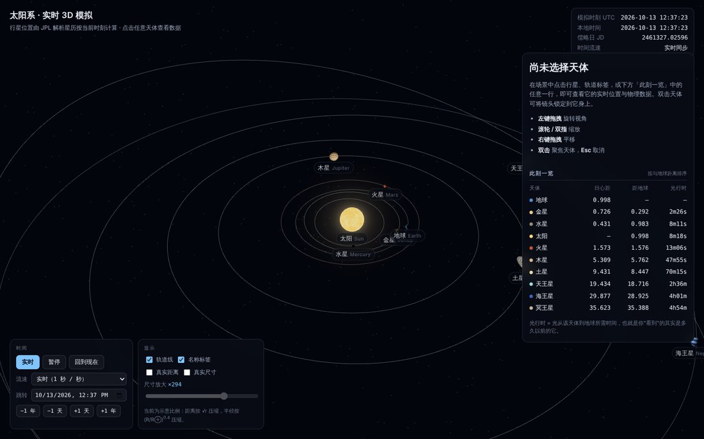
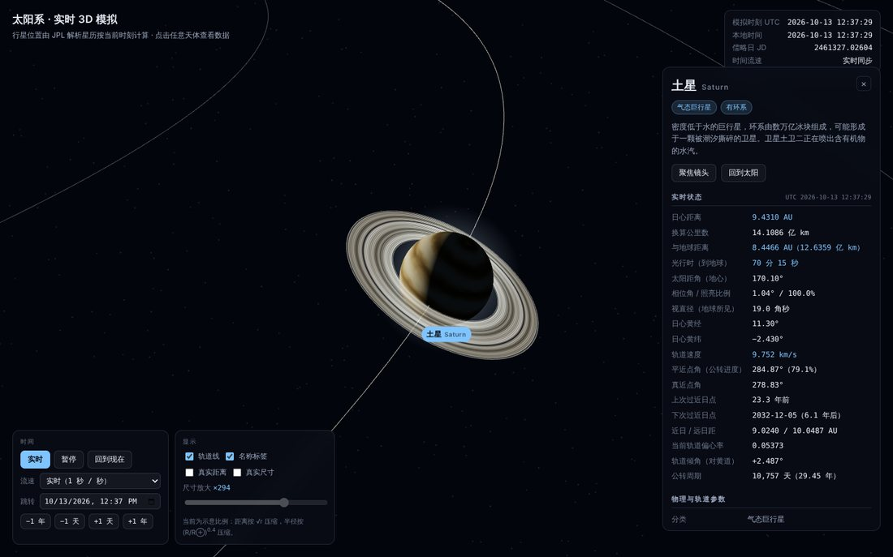

# 太阳系 · 实时 3D 模拟

一个单页、零依赖安装、**双击即可打开**的太阳系三维模拟。行星位置不是动画循环，而是按**当前真实时刻**由 JPL 解析星历算出来的；点击任意天体即可查看它此刻的日心距离、与地球的距离、光行时、轨道速度、相位角等实时量，以及物理与轨道参数。




---

## 1. 运行

```bash
# 方式一：直接双击（推荐，无需任何工具链）
open solar-system-3d/index.html        # macOS
start solar-system-3d\index.html       # Windows

# 方式二：本地服务器（若浏览器对 file:// 有额外限制）
cd solar-system-3d && python3 -m http.server 8080
# 浏览器打开 http://localhost:8080
```

无需 npm install、无构建步骤、无外部网络请求（three.js 已内置，纹理全部运行时程序化生成）。
要求：支持 WebGL 的现代浏览器。已在 Chromium 上验证；Firefox / Safari 同样使用标准 API，但未逐一实测。

## 2. 操作

| 操作 | 效果 |
| --- | --- |
| 左键拖拽 | 旋转视角 |
| 滚轮 / 双指捏合 | 缩放 |
| 右键或中键拖拽 | 平移 |
| 单击天体 / 标签 / 右侧列表 | 选中并显示数据 |
| 双击天体 | 镜头锁定跟随 |
| `Esc` | 取消选择与跟随 |
| `空格` | 暂停 / 继续 |
| `0`–`9` | 依次选中 太阳、水星…冥王星 |
| `F` / `R` / `O` / `L` | 聚焦 / 回到现在 / 轨道线 / 标签 |

时间面板支持：实时同步、1 分钟~1 年每秒的流速、暂停、任意日期跳转、±1 天 / ±1 年步进。
显示面板支持：轨道线、名称标签、**真实距离**、**真实尺寸**（含 ×1–×3000 放大滑杆）。

## 3. 文件结构

```
solar-system-3d/
├── index.html              页面骨架（控件与面板的静态结构）
├── styles.css              界面样式
├── src/
│   ├── ephemeris.js        轨道要素与开普勒求解 → 日心黄道坐标
│   ├── data.js             天体静态数据（物理参数、调色板、渲染参数）
│   ├── textures.js         程序化纹理（值噪声 / fBm，Canvas 像素级生成）
│   ├── controls.js         自写轨道相机（含拖拽与点击的区分）
│   ├── app.js              场景搭建、比例映射、拾取、主循环
│   └── ui.js               标签、信息面板、时间与显示控制
├── vendor/three.bundle.js  three.js r169（MIT），由下方脚本生成
└── tools/make-three-bundle.mjs  把官方 ESM 构建改写成全局脚本
```

分层原则：`app.js` 只管场景与状态，`ui.js` 只读状态写 DOM，两者通过 `SolarSystem.App.state` 单向耦合。

## 4. 关键设计决策与取舍

### 4.1 为什么不用 ES module + OrbitControls

浏览器在 `file://` 下禁止加载 ES module。要让文件双击可用，就不能用 `import`，也就用不了 `three/examples/jsm` 里的 `OrbitControls`。
于是：把官方 ESM 构建的末尾 `export{...}` 机械改写为 `window.THREE = {...}`（`tools/make-three-bundle.mjs`，只改这一处），相机控制自己写 150 行。
附带收益：能精确区分「拖拽」与「点击」（位移 < 6 px 且 < 450 ms 才算点击），这对小目标拾取很关键。

### 4.2 位置怎么算

采用 Standish / JPL《Keplerian Elements for Approximate Positions of the Major Planets》(1800–2050) 的六要素线性模型：

```
要素(T) = 要素₀ + 变化率 · T,  T = (JD − 2451545.0) / 36525
M = L − ϖ  →  牛顿迭代解 E − e·sinE = M  →  轨道面坐标  →  三次旋转(ω, I, Ω) → J2000 日心黄道坐标
```

**精度边界（重要）**：这是解析近似，不是 DE440 数值积分星历。内行星黄经误差约 10 角秒量级，木星土星可达数角分，冥王星更差；未做 TT−UTC（约 69 s）修正，也未计行星互相摄动。用来回答"此刻火星大概在哪、离我们多远"完全够用；**不可用于掩星预报、历表级计算或任何需要角秒精度的场合**。

验证方式：与公开历表交叉核对若干可独立检验的量级，例如 2026-10-13 的地心太阳视黄经约 199.8°（符合 10 月中旬太阳位于天秤座约 20° 的事实）、土星下次过近日点 2032-12（符合其 1944/1974/2003 的近日点序列）、地球日心距 0.998 AU（10 月正趋向 1 月近日点）。

### 4.3 比例：三种映射，默认是"示意"

真实比例下，若太阳画成 1 px，海王星在约 2.4 m 外 —— 行星全部不可见。可视化必须压缩，关键是**把压缩方式讲清楚**而不是偷偷缩放：

| 模式 | 距离映射 | 半径映射 |
| --- | --- | --- |
| 示意（默认） | `d = 10·√r`（保序，保留相对疏密，压缩外围空旷） | `R = 0.38·(R/R⊕)^0.4`（小天体可见，大天体不霸屏） |
| 真实距离 | `d = 10·r`（线性，1 AU = 10 单位） | 同上 |
| 真实尺寸 | 同选择 | `R = 真实半径 × 放大倍数`，倍数拉到 ×1 即严格真实 |

另有一条防御性限幅：任何天体显示半径不超过自身轨道半径的 45%（太阳以水星轨道为参照取 35%），否则"真实尺寸 + 大倍数"会让太阳吞掉内行星。**限幅一旦生效，界面上会明确标注**，以免把被截断的尺寸误读成真实比例。

### 4.4 拾取用屏幕空间而非射线求交

压缩比例下行星常常只有 2–8 px，`Raycaster` 对球体求交几乎点不中。改为把天体中心投影到屏幕，比较像素距离，容差取 `max(16 px, 屏幕半径 + 10 px)`。代价是遮挡关系被忽略（被太阳挡住的行星仍可点中），换来的是符合直觉的点击手感。

### 4.5 纹理全部程序化

9 个天体的表面贴图在运行时用 Canvas 逐像素生成（值噪声 + fBm + 调色板映射）：仓库零贴图资源、离线可用、无版权问题。
经纬度贴图的接缝问题用圆柱采样解决：把经度映射到 `(cosθ·cosφ, sinθ·cosφ, sinφ)` 再取 3D 噪声，经度方向天然闭合。
代价：外观是"示意级"的，不是探测器真实影像——木星的大红斑位置、火星极冠是按参数摆的，不代表真实地貌。

### 4.6 其它工程细节

- **时间推进**：每帧 `dt` 上限 0.5 s。设太小，低帧率机器上「30 天/秒」会名不副实；不设限，后台标签页切回时会瞬间跳过大段时间。
- **相机阻尼**：用 `1 − e^(−9·dt)` 而非固定系数，保证低帧率下也能跟上目标。
- **深度缓冲**：开启对数深度缓冲，真实比例模式下场景跨越约 5 个数量级。
- **DOM 更新**：文本按 ~9 Hz 节流，表格结构只建一次、之后只改单元格文本（避免打断文本选择与闪烁）；标签位置每帧更新。
- **自转相位**以 J2000 为零点计算，时间来回拖动时可复现，而不是逐帧累加。

## 5. 已知局限

1. 不含卫星（月球、伽利略卫星等）、小行星带、彗星。
2. 冥王星的解析星历精度最低，仅供示意（界面上已标注）。
3. 轨道线按当前时刻的要素冻结绘制，不表现长期摄动与进动。
4. 压缩距离模式下轨道形状被径向压缩，偏心率的视觉表现会减弱（真实距离模式下恢复）。
5. 没有光照遮挡：不做行星投影、环影与日食。
6. 卫星数量按 2024 年已确认值，外行星小卫星仍在陆续发现。

## 6. 可扩展方向

- 加入月球与伽利略卫星（需要 ELP/L1 类的卫星历，或接受更粗的圆轨道近似）。
- 接 JPL Horizons API 做在线校正，并与本地解析解对比显示误差。
- 加"从地球看"的星空模式：把日心坐标转为地心赤道坐标，叠加星座。
- 加视星等模型（相位函数 + 距离项），让亮度排序也成为实时数据。

## 7. 重新生成 three.js 包

```bash
curl -L -o /tmp/three.module.min.js \
  https://cdn.jsdelivr.net/npm/three@0.169.0/build/three.module.min.js
node tools/make-three-bundle.mjs /tmp/three.module.min.js vendor/three.bundle.js
```

## 8. 验证

```bash
npm i -D playwright && npx playwright install chromium   # 仅测试需要
node tests/smoke.mjs
```

`tests/smoke.mjs` 以 `file://` 打开页面并断言 22 项：WebGL 是否出图、各行星日心距是否落在自身近/远日距之间、地球公转速度是否 ≈29.8 km/s、实时模式与系统时钟的偏差是否 <1 s、画布点击能否选中、拖拽是否被误判为点击、流速与暂停是否生效、两种距离映射下海王星/地球的距离比是否分别 ≈30 与 ≈√30、运行期间有无 JS 异常。本仓库当前提交下 22 项全部通过（Chromium + SwiftShader 软件渲染）。

## 9. 数据来源

- 轨道要素：E. M. Standish, *Keplerian Elements for Approximate Positions of the Major Planets*, JPL Solar System Dynamics.
- 物理参数：NASA Planetary Fact Sheet / JPL Solar System Dynamics.
- 渲染引擎：[three.js](https://threejs.org/) r169，MIT License（见 `vendor/three.bundle.js` 头部版权声明）。
